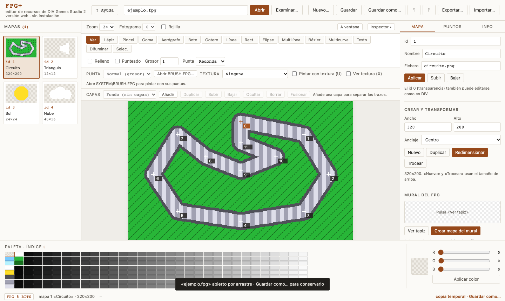
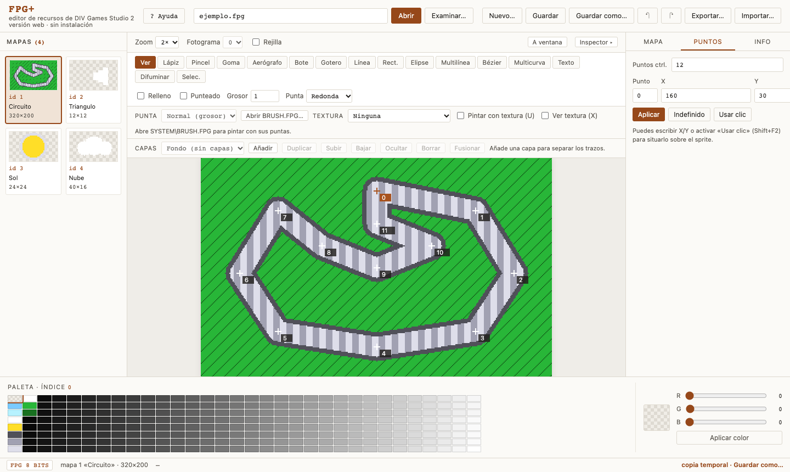

# FPG+ Edit

Editor y herramientas libres para los recursos gráficos de **DIV Games
Studio 2**: los ficheros FPG, MAP, PAL y FNT.

Si has hecho alguna vez un juego con DIV, te habrás encontrado con que sus
gráficos se editan en un programa que ya no funciona en un Windows de hoy, ni
en ningún otro sistema. FPG+ Edit es esa herramienta, otra vez, y además
gratis: abre los ficheros de tu juego, te deja pintarlos como en un editor de
píxeles normal, y los vuelve a guardar **exactamente igual que estaban** —
byte a byte, con la misma compresión, los mismos nombres y los mismos puntos
de control.



Hay dos versiones que salen del mismo código y se ven igual:

| | versión local | versión web |
|---|---|---|
| Arranque | `fpgplusedit.exe` (servidor HTTP en `127.0.0.1`) | se sube a un alojamiento estático |
| Núcleo | `div2serve` | `div2wasm.wasm` (WebAssembly) |
| Ficheros | los abre y guarda el servidor en el disco | los abre y guarda el navegador |
| Instalación | ninguna (Windows) | ninguna (solo un navegador) |
| Para qué | trabajar con ficheros del equipo | probar sin instalar nada, o publicar |

La interfaz (`web/`) es la misma en ambos casos. Al arrancar se pregunta a sí
misma si tiene un servidor detrás: si `/api/state` responde, va en modo local;
si no, carga el `.wasm` y pasa a modo web. De ahí que la misma carpeta `web/`
valga para las dos.

---

## Empezar en dos minutos

1. **Abre un recurso.** «Abrir» o `Ctrl+O` para uno que ya tengas; «Examinar…»
   lista la carpeta. También vale arrastrar el fichero sobre la ventana.
2. **O crea uno.** «Nuevo…» o `Ctrl+N` abre un diálogo donde se elige el tipo
   —FPG de 8 o 16 bits, MAP de 8 o 16 bits, PAL o FNT— y, cuando toca, el ancho,
   el alto y el nombre del mapa. Un FPG nace con un primer mapa en blanco, listo
   para pintar. Después se pide la ruta donde dejarlo.
3. **Pinta.** Las herramientas están en la barra del lienzo (lápiz, pincel, goma,
   formas, texto…); el color se toma de la paleta del dock inferior. El inspector
   de la derecha ajusta el mapa, sus puntos de control y sus datos.
4. **Guarda.** `Ctrl+S` escribe encima; `Ctrl+Shift+S` («Guardar como…») deja una
   copia. `Ctrl+Z` y `Ctrl+Y` deshacen y rehacen.

En la versión web el paso de la ruta lo sustituye el diálogo del navegador: se
elige dónde se escribe y, tras el primer guardado, `Ctrl+S` ya no pregunta.

Si no tienes ficheros de DIV a mano, hay una escena completa en
[`ejemplos/`](ejemplos/): un circuito con doce puntos de control y un
triángulo que lo recorre.

El botón **«? Ayuda»** de la cabecera (o `F1`) abre una guía dentro del
editor con lo esencial: qué es cada tipo de fichero, cómo empezar y todos los
atajos.

---

## Cómo usar esto con DIV Games Studio

DIV guarda sus gráficos en cuatro formatos, y este editor los abre todos:

| Formato | Qué es | En DIV se carga con |
|---|---|---|
| **FPG** | Una caja con varios gráficos y su paleta | `load_fpg("mio.fpg")` |
| **MAP** | Un gráfico suelto | `load_map("mio.map")` |
| **PAL** | Una paleta de 256 colores | `load_pal("mio.pal")` |
| **FNT** | Una fuente de 256 caracteres | `load_fnt("mio.fnt")` |

### El camino corto

1. **Abre en DIV el juego que quieras tocar.** Los gráficos suelen estar en
   la carpeta `SYSTEM` o en una subcarpeta con el nombre del juego, dentro de
   la del proyecto.
2. **Abre ese fichero en FPG+ Edit** y retócalo: pinta, mueve los puntos de
   control, cambia la paleta, recorta un gráfico.
3. **Guárdalo** con `Ctrl+S`. El fichero queda con el mismo tamaño, la misma
   compresión y el mismo nombre de antes. Si el juego no lo carga de otra
   manera, DIV ni se entera de que lo has tocado.
4. **Vuelve a DIV y dale a F5.** Tu juego, con tus gráficos.

Eso es todo. No hay conversores de por medio ni que cambiar nada en el
código.



### Los puntos de control, que es lo mejor que tiene esto

Un gráfico de DIV puede llevar **puntos de control**: unas marcas que le
dices al motor «por aquí puede pasar el sprite». Un cohete que dispara desde
un punto, una flecha que señala la salida, una secuencia de puntos que un
enemigo recorre.

En el editor se colocan con `Shift+F2` (o con «Usar clic» en la pestaña
**Puntos**) y se arrastran con el ratón. En DIV se leen así:

```
get_point(fichero, 1, punto, offset x_punto, offset y_punto);
angle=fget_angle(x, y, x_punto, y_punto);
advance(3);
```

El programa de ejemplo que hay en [`ejemplos/DIV/ejemplo.prg`](ejemplos/DIV/ejemplo.prg)
hace exactamente eso: el triángulo va al punto de control que le toca, gira
hacia él y avanza. Los doce puntos los puedes mover aquí y el programa no
cambia ni una línea.

### La paleta

El editor trae las 256 muestras en el dock de abajo y los tres sliders (R, G y
B) para retocarlas. Los componentes van de 0 a 63, como en DIV, y no de 0 a
255: es el formato de siempre, con su tabla de gamas.

El índice **0 es transparente**, igual que en DIV. Por eso, en un recurso de
16 bits, el negro puro (`0x0000`) no se ve: es el hueco por el que asoma lo
de debajo. Para pintar un negro que se note, usa un tono casi negro, como
`0x0001`.

### Si prefieres no usar el editor de gráficos

También se puede trabajar por línea de comandos, y con cualquier script:

```
div2fpg list    ejemplos/DIV/ejemplo.fpg
div2fpg extract ejemplos/DIV/ejemplo.fpg --out salida --format png
div2fpg create  MI_FPG.fpg sprite1.png sprite2.png --gzip
div2fpg palette ejemplos/DIV/ejemplo.fpg --out salida.pal --png paleta.png
```

---

## Ejemplos

En [`ejemplos/`](ejemplos/) hay una escena completa: el circuito, el
triángulo, el sol, la nube, la paleta y el programa de DIV que lo mueve todo.
Los ficheros los genera el propio núcleo del proyecto, así que se pueden
rehacer a tu medida:

```
cargo run --example generar-ejemplos -p div2fpg
```

Las capturas de este README son de esos mismos ficheros.

---

## Qué hace el editor

- Abrir FPG (`fpg`/`f16`), MAP (`map`/`m16`), PAL y FNT del disco, con
  explorador de ficheros integrado o soltando el fichero sobre la ventana.
- Ver los mapas/sprites del FPG con zoom entero (1×–8×), rejilla y lectura del
  píxel bajo el cursor (coordenada, RGB e índice de paleta).
- Dibujar sobre el mapa como en un editor de píxeles: lápiz, aerógrafo, bote de
  pintura, formas, selección con recortes que se mueven y se fijan con Intro,
  capas y rotación libre, con deshacer y rehacer. Vale igual para mapas de 8 y
  de 16 bits.
- Trazos largos, como los del taller original: multilínea, curva de Bézier y
  multicurva se van marcando con clics y se cierran con Intro; el texto se
  estampa sobre el lienzo y la barra de punteado deja los trazos a cuadros.
- Puntas y estampas: se abre `BRUSH.FPG` de `SYSTEM` y sus puntas de varios
  colores se sellan tal cual; además, cualquier mapa del FPG puede hacer de
  textura repetida al pintar, con la opción de verla antes sobre el lienzo.
- Puntos de control del sprite sobre el propio lienzo (`Shift+F2`): se colocan
  con un clic y se mueven arrastrándolos, con X/Y a la vista. `K` abre el
  gráfico en una ventana aparte y lo copia al portapapeles.
- Crear y transformar mapas: mapa nuevo (en blanco, duplicado o añadido al FPG),
  redimensionar y recortar con anclaje, trocear en baldosas y convertir el FPG
  entero en un mural y al revés, con vista previa.
- Editar la paleta de 256 colores (componentes de 0 a 63) con vista previa.
- Navegar los fotogramas de los mapas animados y los glifos de las fuentes.
- Importar imágenes (PNG, BMP, PCX, JPEG) como nuevos mapas de un FPG.
- Exportar mapas y fotogramas a PNG, BMP, PCX y JPEG.
- Crear recursos nuevos con un diálogo que pide tipo y medidas: FPG de 8 o 16
  bits, MAP de 8 o 16 bits, PAL y FNT. Guardar (conservando el GZIP original) y
  guardar como.

La interfaz está en `web/` (`index.html`, `style.css`, `app.js` y `backend.js`),
sin dependencias externas. `backend.js` es la pieza que decide entre servidor y
WebAssembly; `app.js` no sabe en cuál de los dos está.

---

## Compilar

Requiere una toolchain GNU de Rust. Con `cargo` en el PATH:

```
cargo build --release
cargo test
```

Los binarios quedan en `target/release/` (`fpgplusedit.exe`, `div2fpg.exe`). La
versión web necesita además el destino de WebAssembly:

```
rustup target add wasm32-unknown-unknown --toolchain stable-x86_64-pc-windows-gnu
```

## Empaquetado release reproducible

### Versión local (Windows)

Para generar siempre la misma carpeta de distribución, con el editor ya listo y
su `web/` al lado del ejecutable:

```powershell
.\build_release.ps1
```

Si además quieres validar el workspace antes de empaquetar:

```powershell
.\build_release.ps1 -RunTests
```

El script compila con `--release --locked` y deja el paquete en
`target\package\FPGPlusEdit-<version>-windows-gnu\`, con estos ficheros:

- `fpgplusedit.exe`
- `div2fpg.exe`
- `web\index.html`
- `web\style.css`
- `web\app.js`
- `web\backend.js`
- `docs\capturas\*.png` (las capturas del README)
- `README.md`
- `LICENSE`
- `SHA256SUMS.txt`

### Versión web (estática)

```powershell
.\build_web.ps1
```

Compila `div2wasm` a `wasm32-unknown-unknown` y monta una carpeta **estática** en
`target\package\FPGPlusEdit-<version>-web\` que se puede publicar tal cual, sin
servidor de aplicaciones:

- `index.html`
- `style.css`
- `app.js`
- `backend.js`
- `div2wasm.wasm`
- `LICENSE`

El script imprime el tamaño y el SHA256 del `.wasm`.

## La versión web

No hace falta instalar nada: la página lleva dentro el núcleo de edición
compilado a WebAssembly, así que los ficheros no pasan por ningún servidor.

**Probarla en local.** Hay que servirla por HTTP; una URL `file://` no vale,
porque el navegador no deja leer el `.wasm` desde el disco:

```powershell
cd target\package\FPGPlusEdit-0.1.0-web
python -m http.server 8000     # y abre http://localhost:8000/
```

**Publicarla.** Se copia el contenido de esa carpeta a cualquier alojamiento de
ficheros estáticos (GitHub Pages, Netlify, Cloudflare Pages, un Apache
cualquiera…). No necesita nada más: ni PHP, ni Node, ni base de datos.

**Cómo abre y guarda los ficheros.** Con la File System Access API
(`showOpenFilePicker`/`showSaveFilePicker`), que da acceso de escritura al
fichero elegido, de modo que `Ctrl+S` guarda encima sin preguntar. En los
navegadores que no la tienen (Firefox, Safari) se recurre a un
`<input type="file">` para abrir y a una descarga para guardar.

**Comprobación automática.** `tools/check-web.mjs` carga `web/backend.js` tal
cual lo carga la página, se queda en modo web y hace contra el núcleo
WebAssembly el mismo recorrido que haría alguien con el ratón: abrir
`BRUSH.FPG`, mirar sus mapas, pintar un píxel, guardar, exportar un PNG, soltar
un fichero y crear recursos nuevos de los cuatro tipos. Lo que más se vigila es
que el fichero que sale vuelva a ser idéntico al que entró.

```
cargo +stable-x86_64-pc-windows-gnu build --release --locked --target wasm32-unknown-unknown -p div2wasm
node tools/check-web.mjs
```

## El editor local (`fpgplusedit`)

```
fpgplusedit [--port <n>] [--web <dir>] [--no-open]
```

Arranca un servidor en `127.0.0.1` (puerto 4711 por defecto) y abre el navegador
con la interfaz. Aquí la interfaz va contra el servidor, así que los ficheros se
leen y se escriben en el disco del equipo. La carpeta `web/` se busca junto al
ejecutable o en `web/` del proyecto; con `--web` se puede indicar otra
ubicación.

## Uso de la CLI

```
div2fpg list    <fichero>                     # lista los mapas de un FPG
div2fpg extract <fichero> [--out <dir>] [--format png|bmp] [--id <id>]
div2fpg create  <salida.fpg> <imagen...> [--gzip]
div2fpg add     <fichero.fpg> <imagen...>     # añade mapas
div2fpg remove  <fichero.fpg> <id...>         # elimina mapas por id
div2fpg palette <fichero> [--out <salida.pal>] [--png <salida.png>]
div2fpg map2png <fichero.map> <salida.png>
div2fpg info    <fichero>                     # cabecera y formato detectado
```

Ejemplos:

```
div2fpg info BRUSH.FPG
div2fpg extract BRUSH.FPG --out salida --format png
div2fpg create MI_FPG.fpg sprite1.png sprite2.png --gzip
div2fpg map2png HELP.MAP help.png
div2fpg palette DIV.PAL --out copia.pal --png paleta.png
```

En caso de error cada subcomando imprime un mensaje claro y sale con código
distinto de cero.

## Cómo está hecho

Se compone de cinco crates:

- **`div2fmt`** — librería con los parsers/serializadores, el renderizado a
  imágenes y la conversión a/desde PNG, BMP, PCX y JPEG. Soporta GZIP
  transparente (los ficheros pueden estar comprimidos sin extensión `.gz`).
- **`div2core`** — la lógica de edición (abrir, editar, guardar, exportar,
  importar…) sin saber dónde están los ficheros. Habla con el almacenamiento a
  través del rasgo `Fs`, y es lo que comparten las dos versiones.
- **`div2serve`** — versión local: servidor HTTP (solo `std`) que sirve la
  interfaz y expone la API sobre `div2core`, leyendo y escribiendo en el disco.
  Binario `fpgplusedit`.
- **`div2wasm`** — versión web: el mismo `div2core` compilado a WebAssembly,
  sin `wasm-bindgen` ni pegamento generado.
- **`div2fpg`** — herramienta de línea de comandos (usa `clap`).

## Formatos

- **FPG**: contenedor de mapas/sprites (`fpg` a 8 bits con paleta común, `f16`
  a 16 bits sin paleta). Los bloques de mapa se leen hasta EOF.
- **MAP**: mapa individual (`map`/`m16`).
- **PAL**: paleta de 256 colores (6 bits por componente) + tabla de gamas.
- **FNT**: fuente de 256 caracteres con paleta y descriptores por carácter.

Los enteros son little-endian. El índice 0 de la paleta es transparente.

## Límites y garantías

La copia byte a byte es la regla de la casa: al guardar un fichero sin tocar sus
mapas, lo que sale es idéntico a lo que entró (mismo SHA256), incluidos el campo
`regsize` de cada bloque —que cuenta puntos de control y animación, no solo los
píxeles— y la compresión GZIP original. De ahí salen los `tests/fixtures` y la
ida y vuelta que vigila `tools/check-web.mjs`.

Para que una petición retorcida no tumbe el editor, ni el del navegador, hay
unos topes:

| Qué | Tope |
|---|---|
| Tamaño de un mapa | 4096×4096 |
| Búfer de un mapa (todos los fotogramas juntos) | 256 MB |
| Baldosas de un troceado | 4096 |
| Imagen que se importa | 4096×4096 |
| Cuerpo de una petición al servidor local | 512 MB |

El servidor local escucha en `127.0.0.1` y solo responde a `127.0.0.1`,
`localhost` y `::1`: cualquier otro `Host` se descarta, de modo que una página
ajena no puede alcanzar la API por *DNS rebinding*. Los ficheros estáticos se
sirven únicamente desde `web/`.

## Licencia

GPL-3.0-or-later. Ver [`LICENSE`](LICENSE).

Los ficheros de [`tests/fixtures/`](tests/fixtures/) son de DIV Games Studio 2
y se reparten sin modificar, solo como datos de prueba; su origen y su
situación están explicados en
[`tests/fixtures/README.md`](tests/fixtures/README.md).
