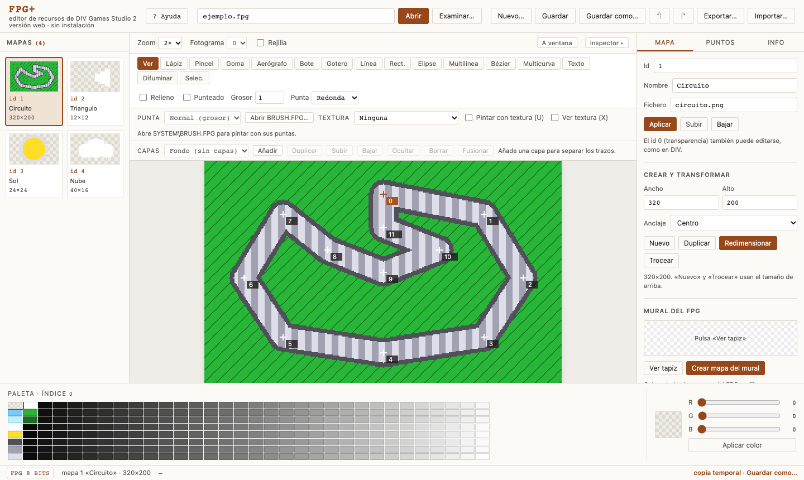

# Ejemplos

Aquí hay una escena completa y lista para usar: un circuito con un triángulo
que lo recorre. Son tres ficheros y un programa de DIV que los carga, tal y
como lo haría un juego de verdad.

| Fichero | Qué es |
|---|---|
| `DIV/ejemplo.fpg` | Los gráficos: el circuito, el triángulo, el sol y la nube. Lleva su propia paleta. |
| `DIV/ejemplo.pal` | La paleta de 256 colores, suelta, por si quieres usarla en otro fichero. |
| `DIV/ejemplo.prg` | El programa de DIV que carga lo anterior y pone el triángulo a dar vueltas. |

> El `.prg` está en ASCII con finales de línea CRLF, como los ficheros de
> código que trae el propio DIV Games Studio. Si lo abres en un editor de
> texto moderno, guárdalo con esos mismos finales de línea para que DIV lo
> lea sin quejarse.

## Los gráficos de dentro

El `ejemplo.fpg` tiene cuatro mapas:

| Id | Nombre | Tamaño | Puntos de control |
|---|---|---|---|
| 1 | `Circuito` | 320×200 | 12 |
| 2 | `Triangulo` | 12×12 | 1 |
| 3 | `Sol` | 24×24 | — |
| 4 | `Nube` | 40×16 | — |

Los doce puntos de control del circuito son lo interesante: marcan el camino
que sigue el triángulo. En el editor se ven encima del propio lienzo, con su
número, y se pueden arrastrar para moverlos.



## Cómo se han hecho

Los ficheros no están escritos a mano: los genera el propio núcleo del
proyecto, así que lo que sale es exactamente lo que DIV espera. Para
rehacerlos (por ejemplo, si cambias la paleta o el trazado):

```
cargo run --example generar-ejemplos -p div2fpg
```

Eso reescribe `DIV/ejemplo.fpg` y `DIV/ejemplo.pal`. El programa está en
[`crates/div2fpg/examples/generar-ejemplos.rs`](../crates/div2fpg/examples/generar-ejemplos.rs)
y se puede cambiar a tu gusto: la paleta, el trazado del circuito, el número
de puntos de control, los colores.

## Abrirlos en el editor

1. Arranca el editor (versión local o la web, lo que prefieras).
2. «Abrir» y elige `DIV/ejemplo.fpg`.
3. En la tira de la izquierda verás los cuatro mapas. Elige `Circuito` para ver
   la pista y sus doce puntos de control.

Desde ahí puedes pintar sobre el circuito, mover los puntos, cambiar la
paleta, exportar el mapa a PNG… lo de siempre.

## Usarlos en DIV Games Studio

Esto es lo que hay que hacer para verlos moverse:

1. Abre DIV Games Studio 2.
2. Copia la carpeta `DIV` entera dentro de la carpeta de tu proyecto de DIV
   (la que tiene los ficheros `.PRG`).
3. Abre `ejemplo.prg` con el editor de código de DIV y dale a **F5** para
   compilar y ejecutar.

El programa hace esto:

```
fichero=load_fpg("ejemplo.fpg");   // los gráficos
load_pal("ejemplo.pal");            // la paleta
put(fichero, 1, 0, 0);              // el circuito, de fondo
graph=2;                            // el triángulo
```

Y luego, en cada vuelta del bucle, va leyendo el punto de control que le
toca y gira hacia él:

```
get_point(fichero, 1, punto, offset x_punto, offset y_punto);
angle=fget_angle(x, y, x_punto, y_punto);
advance(3);
FRAME;
```

Si prefieres cambiar el recorrido, mueve los puntos de control en el editor,
guarda y vuelve a ejecutar: el programa no cambia, los puntos sí.

### Si esto te suena nuevo

Lo mínimo para usar gráficos tuyos con DIV:

- Un **FPG** guarda varios gráficos con su paleta. `load_fpg("mio.fpg")`
  devuelve el código del fichero, que luego se usa en `put()` y `get_point()`.
- Un **MAP** es un gráfico suelto. `load_map("mio.map")`.
- Una **PAL** son 256 colores. `load_pal("mio.pal")`. También puedes sacarla
  de un FPG: `load_pal("mio.fpg")`.
- Una **FNT** es una fuente de 256 caracteres, para escribir texto con
  `write()`. `load_fnt("mio.fnt")`.
- Los **puntos de control** de un gráfico son las marcas por las que un
  sprite puede ir: la boca de un cañón, la punta de una flecha que señala la
  salida. Se colocan en el editor y se leen con `get_point()`.

El apartado «Cómo usar esto con DIV Games Studio» del [README](../README.md)
explica el mismo camino paso a paso.
